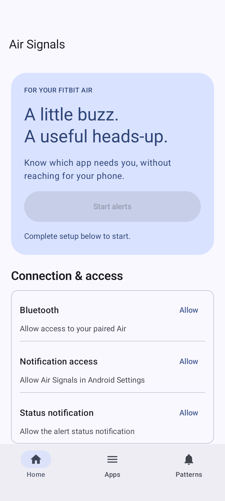
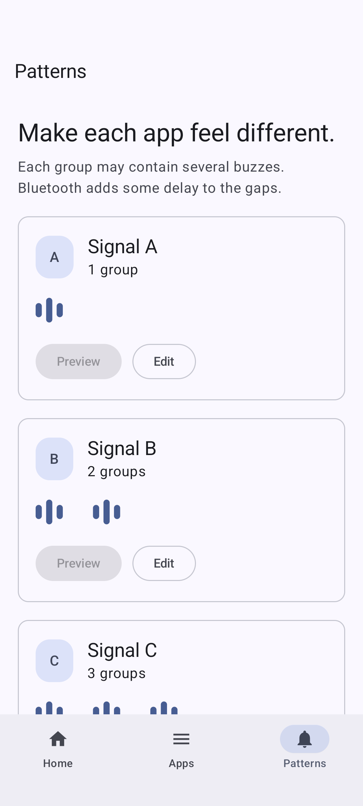

# Air Signals

Android notification-to-vibration bridge for Fitbit Air. Version 0.5 adds a Material 3 UI; the working 0.4 baseline is preserved in commit `ba7703a`. The app supports per-app A/B/C groups, a user-started foreground relay, burst coalescing and strength restoration checks.

## Build

Use Java 21 and Android SDK 36. Set `JAVA_HOME` and `ANDROID_HOME`, then run:

```sh
./gradlew :app:assembleDebug :app:lintDebug
```

The APK is generated at `app/build/outputs/apk/debug/app-debug.apk`. The Gradle wrapper and dependency versions are pinned. Signing keys, local SDK paths and build outputs are ignored. The pre-Compose build helper is available in the baseline commit; use Gradle for the current UI. The installed 0.4 build used a separate local diagnostic signing key; retain that identity when installing an upgrade.

## Source and provenance

- `app/src`: modified transport, native host and minimal Flutter channel adapters.
- `app/assets/licenses`: upstream and runtime dependency notices.
- `vendor/fitbit-air`: upstream ARM64 Golden Gate native libraries.
- `app/provenance.json`: source URL, exact commit and modifications.
- `docs/guide.txt`: setup and behavior.
- `docs/validation`: device results and explicit validation limits.

Transport upstream: https://github.com/ThoreKoritzius/fitbit-air at `5f76f5f8d48d1dab420feeebc6ac87f52be78ba4`. No Google Health code, APKs, credentials, personal notification content or signing keys are included. See bundled license notices.

## Validation boundary

On the S25+ and Air firmware 67.20001.253.2, the user confirmed distinguishable groups, synthetic notification delivery, locked-phone burst coalescing and delivery after Bluetooth cycling plus manual alert restart. Google Health alarms loaded after the 0.4 trials. Earlier versions intermittently stalled that screen. Battery impact, automatic out-of-range recovery and long-term coexistence remain unverified.

## Android UI

The current UI uses Jetpack Compose and stable Material 3 (1.4.0): dynamic wallpaper colors, system light/dark mode, edge-to-edge Scaffold insets, standard accessible controls, navigation rail on wide windows, scalable typography, scrollable sheets, explicit Save/Cancel for pattern changes and searchable app assignments. Signal groups and the transport are unchanged. The launcher supports adaptive/themed icons; the foreground notification uses the same signal mark.

Guidance checked on 2026-11-02: [Material 3](https://developer.android.com/develop/ui/compose/designsystems/material3), [stable release notes](https://developer.android.com/jetpack/androidx/releases/compose-material3), [window insets](https://developer.android.com/develop/ui/compose/system/insets-ui), and [accessibility defaults](https://developer.android.com/develop/ui/compose/accessibility/api-defaults). No claim of a complete accessibility certification is made.

UI tests only exercise local UI/preferences, including search empty states, disabled start without permissions, cancel versus save, and restoration after activity recreation. They never send BLE commands. Emulator checks and real-device haptic validation have different scopes.

### UI validation results

Debug build and Android lint passed (zero errors, 28 warnings, primarily inherited logging/subscription/style findings and available dependency updates). Six emulator UI checks passed. Screens were visually reviewed in portrait light mode, dark mode at 150% font scale, and a wide window with navigation rail. The checked-in report is `docs/validation/ui-0.5.json`. This is UI/local-preference validation; physical motor results belong to the earlier 0.4 trials. Version 0.5 was installed and opened on the S25+ on 2026-11-06; the installed APK hash matches the validated build. The Home screen was visually checked in dark mode, and existing permissions and the saved test-sender assignment were preserved.

 
